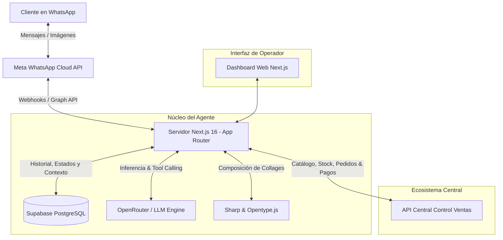
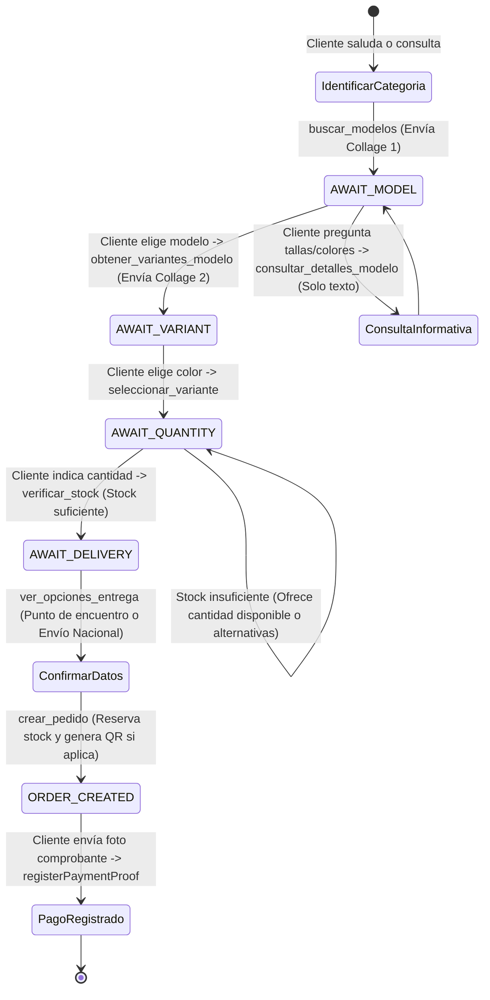
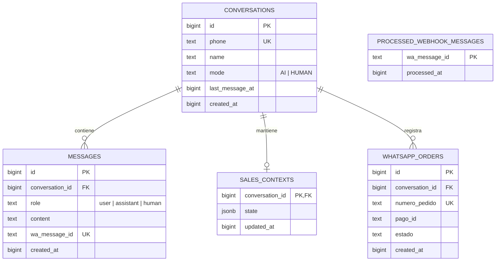

# Documentación Técnica Integral - Agente WhatsApp Fit Andes

**Fecha de revisión:** 2026-10-07  
**Proyecto:** Agente Inteligente de Ventas WhatsApp para Fit Andes  
**Tecnologías principales:** Next.js 16 (App Router), React 19, TypeScript, OpenRouter (GPT-4o-mini), WhatsApp Cloud API (Meta Graph v21.0), Supabase (PostgreSQL), Sharp, Opentype.js.

---

## 1. Resumen Ejecutivo y Propósito

El **Agente WhatsApp Fit Andes** es una solución de comercio conversacional automatizado diseñada para la atención, catálogo visual y cierre de ventas de prendas de vestir (chompas, poleras y ruanas) en Bolivia a través de la API oficial de WhatsApp Cloud de Meta.

El sistema funciona de forma híbrida:
1. **Atención con Inteligencia Artificial (Modo IA):** Un agente basado en LLM (OpenRouter) ejecuta un flujo comercial guiado por herramientas (*tool calling*), genera catálogos visuales personalizados en tiempo real, valida stock en vivo, gestiona opciones de entrega y genera pedidos con reserva atómica en el sistema central de inventario.
2. **Atención Humana (Modo HUMANO):** Un operador puede alternar la conversación a modo manual desde el Dashboard web para intervenir en cualquier momento o cuando el cliente solicita asistencia humana.



---

## 2. Arquitectura de Software y Componentes

El proyecto está estructurado dentro de [`src/`](file:///e:/proyectos/agentes/agente-prueba1/src) siguiendo las convenciones de Next.js App Router:

```
agente-prueba1/
├── src/
│   ├── app/
│   │   ├── api/
│   │   │   ├── connection/status/   # Chequeo de conexión y credenciales de Meta
│   │   │   ├── conversations/       # Lista de conversaciones activas
│   │   │   ├── messages/[id]/       # Mensajes por conversación (GET, POST manual, DELETE)
│   │   │   ├── mode/[id]/           # Conmutación IA / HUMANO
│   │   │   └── webhook/             # Endpoint del Webhook de WhatsApp (GET handshake / POST eventos)
│   │   ├── layout.tsx               # Layout raíz de Next.js
│   │   └── page.tsx                 # Puerta de entrada al Dashboard
│   ├── components/
│   │   ├── ConfigScreen.tsx         # Pantalla de configuración guiada cuando faltan env vars
│   │   ├── ConnectionGate.tsx       # Guardián de estado (conecta a Meta o muestra config)
│   │   ├── ConversationList.tsx     # Barra lateral de chats en tiempo real
│   │   ├── ConversationPanel.tsx    # Panel de conversación, mensajes y controles
│   │   ├── DashboardHeader.tsx      # Cabecera con número verificado y estado
│   │   ├── MessageBubble.tsx        # Burbuja de mensaje individual (usuario, IA, operador)
│   │   └── ModeToggle.tsx           # Selector de modo IA / HUMANO
│   ├── lib/
│   │   ├── catalog-image.ts         # Generador de collages dinámicos con Sharp y Opentype.js
│   │   ├── db.ts                    # Capa de datos con Supabase y lógica de reintentos
│   │   ├── fit-andes-agent.ts       # Definición de herramientas, bucle de ejecución y reglas
│   │   ├── fit-andes-api.ts         # Cliente HTTP para la API Central Control Ventas
│   │   ├── openrouter.ts            # Cliente LLM para fallback directo
│   │   ├── system-prompt.ts         # Prompt de sistema y directrices conversacionales
│   │   ├── fonts/                   # Datos tipográficos en base64 para renderizado en servidor
│   │   └── meta/
│   │       ├── client.ts            # Cliente de Meta Graph API (texto, imagen, media, upload)
│   │       ├── handler.ts           # Procesamiento de webhooks entrantes y deduplicación
│   │       └── verify.ts            # Validación criptográfica HMAC SHA-256 de webhooks
│   └── types/
│       └── next-shim.d.ts           # Shims tipográficos de Next.js
├── supabase/
│   └── migrations/                  # Scripts SQL de estructura de datos
├── API_DOCUMENTACION.md             # Especificación técnica de la API Central
├── package.json                     # Dependencias y scripts del proyecto
└── nixpacks.toml / Procfile         # Configuración para despliegue en la nube
```

---

## 3. Flujo Conversacional y Motor de Ventas

El cerebro comercial está implementado en [`src/lib/fit-andes-agent.ts`](file:///e:/proyectos/agentes/agente-prueba1/src/lib/fit-andes-agent.ts) y regulado por [`src/lib/system-prompt.ts`](file:///e:/proyectos/agentes/agente-prueba1/src/lib/system-prompt.ts).

### 3.1 Etapas del Flujo de Venta



### 3.2 Herramientas Disponibles para el Agente (`Tool Calling`)

| Herramienta | Propósito | Salida Multimedia |
|---|---|---|
| [`buscar_modelos`](file:///e:/proyectos/agentes/agente-prueba1/src/lib/fit-andes-agent.ts) / `buscarPrendas` | Búsqueda ultra-rápida en `/api/integrations/whatsapp/products/search` con fotos Cloudinary (`f_auto,q_auto,w_800`), filtrando por stock real disponible, categoría, talla o color. | Envía **Collage de Modelos** con números, modelo y precio. |
| [`consultar_medidas`](file:///e:/proyectos/agentes/agente-prueba1/src/lib/fit-andes-agent.ts) / `consultarMedidas` | Consulta medidas anatómicas en cm (`anchoPecho`, `anchoHombros`, `largoTotal`, mangas) desde `/api/integrations/whatsapp/products/:id/measurements` para asesorar contextura como sastre experto. | **Sin imagen (Solo texto)**. |
| [`obtener_variantes_modelo`](file:///e:/proyectos/agentes/agente-prueba1/src/lib/fit-andes-agent.ts) | Recupera las variantes disponibles (colores/tallas) del modelo elegido. | Envía **Collage de Variantes** con número y descripción. |
| [`consultar_detalles_modelo`](file:///e:/proyectos/agentes/agente-prueba1/src/lib/fit-andes-agent.ts) | Inspecciona tallas, colores con stock disponible y medidas anatómicas sin enviar imágenes. | **Sin imagen (Solo texto)**. |
| [`seleccionar_variante`](file:///e:/proyectos/agentes/agente-prueba1/src/lib/fit-andes-agent.ts) | Confirma la selección de color y talla del cliente en el estado de la venta. | Ninguna (Actualiza estado). |
| [`verificar_stock`](file:///e:/proyectos/agentes/agente-prueba1/src/lib/fit-andes-agent.ts) | Revalida el inventario en tiempo real para evitar vender stock ya reservado. | Ninguna (Respuesta de stock numérico). |
| [`ver_opciones_entrega`](file:///e:/proyectos/agentes/agente-prueba1/src/lib/fit-andes-agent.ts) / `consultarOpcionesEntrega` | Consulta puntos de recojo en La Paz (teleféricos, tiendas), días, horarios y transportadoras interdepartamentales desde `/api/delivery-options`. | Ninguna. |
| [`enviar_foto_producto`](file:///e:/proyectos/agentes/agente-prueba1/src/lib/fit-andes-agent.ts) | Envía una foto individual de detalle de una variante específica a pedido del cliente. | Envía **Imagen individual** por WhatsApp. |
| [`crear_pedido`](file:///e:/proyectos/agentes/agente-prueba1/src/lib/fit-andes-agent.ts) / `crearPedidoWhatsApp` | Registra el pedido en `/api/integrations/whatsapp/orders`, reserva stock hasta fin de día (La Paz UTC-4) y calcula flete nacional (Bs 10.00). | Si es QR, envía **Imagen del código QR BancoSol** con titular. |
| [`consultar_pedido`](file:///e:/proyectos/agentes/agente-prueba1/src/lib/fit-andes-agent.ts) / `rastrearPedido` | Consulta el estado de pedido en `/api/integrations/whatsapp/orders/:id?phone=...` verificando preparación, pago y despacho. | Ninguna. |
| [`consultar_politicas`](file:///e:/proyectos/agentes/agente-prueba1/src/lib/fit-andes-agent.ts) | Consulta políticas públicas y legales de Fit Andes (devoluciones, cambios y garantías) en `/api/public/politicas`. | Ninguna. |
| [`cancelar_compra`](file:///e:/proyectos/agentes/agente-prueba1/src/lib/fit-andes-agent.ts) | Reinicia el contexto de venta si el cliente desiste o cambia de opinión. | Ninguna. |
| [`derivar_humano`](file:///e:/proyectos/agentes/agente-prueba1/src/lib/fit-andes-agent.ts) | Pasa el chat a modo `HUMAN` y envía alerta de WhatsApp al teléfono del asesor. | Notifica al propietario. |

---

## 4. Generación Gráfica de Collages en Servidor

Uno de los módulos más destacados es [`src/lib/catalog-image.ts`](file:///e:/proyectos/agentes/agente-prueba1/src/lib/catalog-image.ts):

- **Motor:** `sharp` + `opentype.js`.
- **Independencia del Sistema Operativo:** Embebe la tipografía en Base64 ([`font-data.ts`](file:///e:/proyectos/agentes/agente-prueba1/src/lib/fonts/font-data.ts)), convirtiendo caracteres a trazados vectoriales SVG (`pathToSvg`). Esto previene fallos típicos en contenedores Docker/Linux donde no existen fuentes instaladas.
- **Formato Visual:**
  - Mosaico de 2 columnas con bordes redondeados y separación simétrica (`gap: 18px`).
  - Badge circular oscuro con número destacado (1, 2, 3...) para fácil referencia del cliente.
  - Franja inferior semitransparente con nombre del producto y precio en Bolivianos (ej. `Bs 120`).
  - Ajuste de texto dinámico (`fitText`) con elipsis si excede el ancho disponible.
- **Entrega directa:** Se sube el buffer resultante a Meta Graph `/media` y se envía como imagen nativa con pie de foto interactivo.

---

## 5. Integración con Meta WhatsApp Cloud API y Clasificador de Visión

La comunicación se gestiona en [`src/lib/meta/`](file:///e:/proyectos/agentes/agente-prueba1/src/lib/meta) y el subsistema de visión en [`src/lib/vision.ts`](file:///e:/proyectos/agentes/agente-prueba1/src/lib/vision.ts):

1. **Validación de Firma Criptográfica ([`verify.ts`](file:///e:/proyectos/agentes/agente-prueba1/src/lib/meta/verify.ts)):**
   - Valida el encabezado `x-hub-signature-256` utilizando `crypto.createHmac("sha256", META_APP_SECRET)`.
   - Utiliza `crypto.timingSafeEqual` para prevenir ataques de temporización.
2. **Procesamiento de Webhooks y Clasificación Visual ([`handler.ts`](file:///e:/proyectos/agentes/agente-prueba1/src/lib/meta/handler.ts)):**
   - El endpoint responde `200 OK` inmediatamente a Meta y delega el trabajo pesado usando `after(...)` de Next.js.
   - Deduplica mensajes entrantes mediante la tabla `processed_webhook_messages`.
   - **Clasificador con Visión (`analyzeIncomingImage`):** Cuando el cliente envía una imagen:
     - **Comprobante de Pago (`COMPROBANTE`):** Si hay un pedido pendiente (`latestPendingWhatsAppOrder`), se envía automáticamente a `/api/integrations/whatsapp/payments/:id/proof` notificando a Telegram y actualizando a `PROOF_UPLOADED`.
     - **Búsqueda por Foto (`PRENDA`):** Extrae automáticamente `color`, `tipoPrenda`, `tipoCuello` y `patron`. Invoca `buscar_modelos` / `buscarPrendas` para encontrar prendas equivalentes con stock real y responder con el catálogo oficial.
3. **Cliente Meta Graph API ([`client.ts`](file:///e:/proyectos/agentes/agente-prueba1/src/lib/meta/client.ts)):**
   - Envíos de texto: `POST /{phone_number_id}/messages` con `type: "text"`.
   - Envíos de imagen: URLs externas o buffers subidos vía `POST /{phone_number_id}/media`.
   - Descarga de archivos de medios mediante token de portador.

---

## 6. Persistencia y Base de Datos (Supabase PostgreSQL)

Toda la persistencia se gestiona en Supabase vía [`src/lib/db.ts`](file:///e:/proyectos/agentes/agente-prueba1/src/lib/db.ts) con las siguientes tablas:

### 6.1 Esquema de Tablas



### 6.2 Resiliencia y Reintentos Automáticos (`withRetry`)
El cliente de Supabase incluye un envoltorio [`withRetry`](file:///e:/proyectos/agentes/agente-prueba1/src/lib/db.ts#L28) con retroceso exponencial que reintenta automáticamente consultas ante fallos transitorios de red (`Gateway Timeout`, `502`, `503`, `504`, `fetch failed`, `ETIMEDOUT`, `ECONNRESET`), asegurando alta disponibilidad.

---

## 7. Integración con el Sistema Central (Control Ventas)

El conector [`src/lib/fit-andes-api.ts`](file:///e:/proyectos/agentes/agente-prueba1/src/lib/fit-andes-api.ts) se comunica con la API central mediante `WHATSAPP_INTEGRATION_API_KEY`:

- **Búsqueda compacta optimizada con fotos:** `GET /api/integrations/whatsapp/products/search?q=...&color=...&talla=...&limit=...` (<50ms, Cloudinary `f_auto,q_auto,w_800`).
- **Medidas anatómicas para tallas:** `GET /api/integrations/whatsapp/products/:id/measurements` (ancho de pecho, hombros, largo, mangas).
- **Opciones de entrega y transporte:** `GET /api/delivery-options` (puntos de recojo, horarios en La Paz, agencias de encomienda nacional).
- **Creación de pedidos omnicanal:** `POST /api/integrations/whatsapp/orders` (idempotencia por ID de mensaje, reserva a fin de día UTC-4, cálculo de flete nacional Bs 10.00 y QR BancoSol).
- **Rastreo de pedido por celular:** `GET /api/integrations/whatsapp/orders/:id?phone=:phone`.
- **Subida de comprobante de pago:** `POST /api/integrations/whatsapp/payments/:id/proof` (Cloudinary, prórroga 48h y alerta inmediata a Telegram).
- **Políticas públicas:** `GET /api/public/politicas` (cambios, devoluciones y términos).
- **Búsqueda por código de prenda:** `GET /api/productos/by-code/:code` (SKU, código de barras o QR).

---

## 8. Dashboard Web para Operadores

La interfaz web en Next.js permite supervisar y operar las ventas:

1. **Pantalla de Verificación de Conexión ([`ConnectionGate.tsx`](file:///e:/proyectos/agentes/agente-prueba1/src/components/ConnectionGate.tsx)):**
   - Evalúa variables de entorno y conectividad con Meta Graph API.
   - Si falta alguna credencial, presenta una lista interactiva de verificación ([`ConfigScreen.tsx`](file:///e:/proyectos/agentes/agente-prueba1/src/components/ConfigScreen.tsx)).
2. **Bandeja de Conversaciones ([`ConversationList.tsx`](file:///e:/proyectos/agentes/agente-prueba1/src/components/ConversationList.tsx)):**
   - Muestra chats ordenados por última interacción, preview del último mensaje y badge del modo (`IA` o `HUMANO`).
   - Actualización en tiempo real mediante sondeo cada 2 segundos.
3. **Panel de Conversación ([`ConversationPanel.tsx`](file:///e:/proyectos/agentes/agente-prueba1/src/components/ConversationPanel.tsx)):**
   - Historial completo diferenciando burbujas del usuario, del agente y del operador humano.
   - Indicador de error si un mensaje no pudo ser entregado por Meta.
   - Botón para **Alternar Modo** entre IA y HUMANO.
   - Botón para **Limpiar Chat** (para pruebas).
   - Formulario de respuesta manual cuando el chat está en modo `HUMANO` (validando ventana de 24h de Meta).

---

## 9. Variables de Entorno Requeridas

Copiar `.env.example` a `.env.local` y suministrar las claves:

```env
# Meta WhatsApp Cloud API
META_ACCESS_TOKEN=EAAG...             # System User Token permanente
META_PHONE_NUMBER_ID=123456789012345  # ID del número telefónico de WhatsApp
META_WABA_ID=123456789012345          # ID de la cuenta comercial (WABA)
META_APP_SECRET=abcdef0123456789...   # App Secret de Meta Developers
META_VERIFY_TOKEN=tu_token_secreto    # Token para validación inicial de webhook
META_GRAPH_VERSION=v21.0              # Versión de la API Graph

# LLM / OpenRouter (Visión y Tool Calling)
OPENROUTER_API_KEY=sk-or-v1-...       # Clave de API de OpenRouter
OPENROUTER_MODEL=openai/gpt-4o-mini   # Modelo multivariante / visión

# Base de datos Supabase
SUPABASE_URL=https://xxxx.supabase.co
SUPABASE_SERVICE_ROLE_KEY=eyJ...      # Service role key (para bypass de RLS en servidor)

# Sistema Central Fit Andes (control-ventas)
CONTROL_VENTAS_URL=https://control-ventas-azure.vercel.app
WHATSAPP_INTEGRATION_API_KEY=fit_andes_wa_secret_key_2026_fghgsegbvvbdsfe

# Compatibilidad previa (opcional)
CENTRAL_API_URL=https://control-ventas-azure.vercel.app/api
CENTRAL_WHATSAPP_SERVICE_KEY=
```

---

## 10. Guía de Ejecución y Pruebas

### 10.1 Ejecución Local

```bash
# Instalar dependencias
npm install

# Comprobar tipos TypeScript
npx tsc --noEmit

# Iniciar servidor de desarrollo
npm run dev
```

### 10.2 Exposición de Webhook para Pruebas

```bash
# En una terminal auxiliar
ngrok http 3000
```

Configurar en Meta Developers:
- **URL de devolución de llamada:** `https://<tu-subdominio-ngrok>.ngrok-free.app/api/webhook`
- **Token de verificación:** El valor configurado en `META_VERIFY_TOKEN`
- **Campos suscritos:** `messages`

---

## 11. Diagnóstico del Estado Actual del Repositorio

> [!NOTE]
> **Compilación y TypeScript:** El proyecto compila limpiamente sin errores (`npx tsc --noEmit` exitoso).
> **Control de Versiones:** Los conflictos de combinación de ramas entre `HEAD` y `origin/main` en [`fit-andes-agent.ts`](file:///e:/proyectos/agentes/agente-prueba1/src/lib/fit-andes-agent.ts), [`meta/handler.ts`](file:///e:/proyectos/agentes/agente-prueba1/src/lib/meta/handler.ts) y [`system-prompt.ts`](file:///e:/proyectos/agentes/agente-prueba1/src/lib/system-prompt.ts) fueron resueltos y guardados en el commit `version1`.
> **Diferencia con el README original:** El archivo [`README.md`](file:///e:/proyectos/agentes/agente-prueba1/README.md) indicaba erróneamente el uso de *SQLite local en `data/messages.db`*, mientras que el sistema real opera sobre **Supabase (PostgreSQL)** con almacenamiento persistente y migraciones SQL activas.
